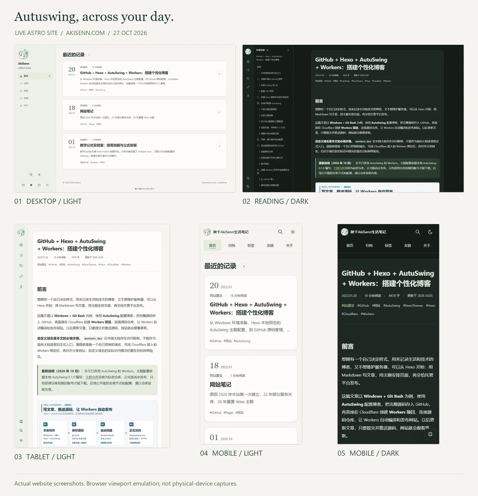

<p align="center">
  <picture>
    <source media="(prefers-color-scheme: dark)" srcset="docs/assets/autuswing-header-dark.svg">
    
  </picture>
</p>

<p align="center">
  <strong>A calmer place to read.</strong><br>
  Classic sidebar · Forest green · Static publishing · Room for your words
</p>

<p align="center">
  <a href="package.json"></a>
  <a href="https://astro.build/"></a>
  <a href="package.json">= 22.22.0"></a>
</p>

<p align="center">
  <a href="README.md">简体中文</a> | <strong>English</strong>
</p>

<p align="center">
  <a href="https://akisenn.com/">Live site</a> ·
  <a href="#preview">Preview</a> ·
  <a href="#quick-start">Quick start</a> ·
  <a href="docs/index.md">Documentation</a>
</p>

---

**Autuswing · 秋漾** is an independent blog theme project built with Astro. Its name brings together **Autu**mn and **Swing**: a gentle breeze, an unhurried rhythm, and a place to write in your own voice.

The familiar blog sidebar stays, alongside date cards, warm forest greens and clear typography. Desktop reading has room to breathe; tablet and phone navigation adapt to smaller screens. Light, dark and system appearance modes sit alongside restrained motion that respects reduced-motion preferences.

> [!NOTE]
> **The site runs on Astro; the repository is still being prepared.** The site maintainer confirms that [akisenn.com](https://akisenn.com/) migrated on October 26, 2026 and passed production and physical-device acceptance. This repository remains private. Package version `0.2.0` is a development version, with no official GitHub Release or version tag. It is not yet a zero-configuration starter. The sealed production candidate differs from this branch; see [source and production status](docs/repository-state.md).

<a id="preview"></a>

## Preview

<p align="center">
  
</p>

Real pages from [akisenn.com](https://akisenn.com/), captured on October 27, 2026 using browser viewport emulation for tablet and phone sizes. The contact sheet arranges the original screenshots without replacing page content. These images show production appearance, not byte-for-byte parity with this branch or a new physical-device test. [All light/dark screenshots and capture details](docs/preview.md).

## Features

This table describes the [documented source baseline](docs/repository-state.md). Optional integrations require configuration; an adapter's presence does not establish that a live external service has passed acceptance.

| Area | Available behavior and limits |
| --- | --- |
| Appearance | Forest greens, date cards, light / dark / system modes; optional site backgrounds and article-card wallpapers |
| Responsive layout | Full desktop sidebar; compact navigation and separate article TOC; tablet rail; mobile top navigation and collapsible TOC |
| Reading | Word counts and reading time, heading links, active TOC, code copying, image viewer, sharing and adjacent posts; the reading progress bar has been removed |
| Markdown | Astro collections, draft isolation, post / tutorial / series templates, tables, footnotes, callouts and code-line annotations; series metadata does not yet create series pages |
| Math | Build-time KaTeX, automatic formula detection, local styles and fonts where needed; legacy math flags do not switch rendering to MathJax |
| Search and navigation | On-demand static search, multiple keywords, keyboard controls, tags, categories, chronological archives and pagination |
| SEO and feeds | Canonical URLs, Open Graph, JSON-LD, robots, verification fields, sitemaps, RSS and Atom; optional full-content feeds |
| PWA | Optional installation, generated icons and an offline fallback; article HTML is not cached for offline reading |
| Performance and delivery | Static Astro output, Vite fingerprints, minification, image processing, optional prefetching and precompression; hosting cache rules need separate setup |
| Configuration | Author, avatar, menus, social links, typography, footer and optional comments / statistics; preview mode isolates live comments and analytics, and external services need separate acceptance |

Reuse by other sites, subpath hosting and a public distribution still need preparation and validation. See [configuration](docs/configuration.md), [appearance](docs/appearance.md) and [writing](docs/writing.md).

<a id="quick-start"></a>

## Quick start

For developers who already have access to this private repository. Use **Node.js ≥ 22.22.0** and a separate working copy; preserve existing work first. The repository contains the owner's content, settings and migration constraints, so do not publish it as your own site unchanged.

```sh
git clone https://github.com/AkiSenn/astro-theme-autuswing.git
cd astro-theme-autuswing
git switch codex/astro-migration
npm ci
npm run dev
```

Open <http://127.0.0.1:4322/>. Commands and features were checked against `f1d0e65` on this branch; later updates may differ. Stop the dev server before checking and previewing a static build:

```sh
npm run check
npm run build
npm run preview
```

The default build writes `dist/` with preview noindex policies. These commands do not deploy. Site identity lives in `src/config/site.json`; theme settings live in `src/config/theme.json`. Production candidates have a separate validation process. [Getting started](docs/getting-started.md) explains the boundaries.

## Documentation

Detailed guides are currently in Simplified Chinese; configuration keys are the same in both interface languages.

| Task | Guide |
| --- | --- |
| Run locally and understand build modes | [Getting started](docs/getting-started.md) |
| Find author, menu and service settings | [Configuration](docs/configuration.md) |
| Customize appearance and reading layouts | [Appearance](docs/appearance.md) |
| Write posts, use drafts, images and math | [Writing](docs/writing.md) |
| Understand permalinks, search and feeds | [SEO and URLs](docs/seo-and-urls.md) |
| Plan static hosting and caching | [Deployment principles](docs/deployment.md) |
| Use the project logo and artwork | [Branding](docs/branding.md) |
| Explore the source and choose checks | [Source guide](docs/source-guide.md) |

[All guides and historical development records →](docs/index.md)

## From Hexo to Astro

[Hexo Autuswing](https://github.com/AkiSenn/hexo-theme-autuswing) is the earlier standalone theme. This project evolves its sidebar and reading design through Astro, with different templates, content collections, builds and delivery. It is more than a runtime swap: the Astro version does not need Hexo, EJS or Hexo theme-installation commands.

Preserving old posts, identifiers and URLs is part of the original site's migration. Future users should not need to copy the owner's posts or repeat that migration. General-purpose setup instructions will follow the agreed distribution scope.

## Verification

Use `npm run check` and `npm test` for routine source checks. Select content, output, browser and visual checks according to the change; see the [source guide](docs/source-guide.md#validation). Historical reports remain historical evidence, not fresh acceptance results. Documentation and artwork changes need link, image, command and rendering checks rather than a full production test rerun.

## License, credits and project status

The [LICENSE](LICENSE) and package metadata at this documentation baseline retain an **MIT declaration**. Filtered snapshots use `UNLICENSED` while project licensing boundaries are investigated. The existing MIT declaration does not replace provenance review or authorize a public release. This documentation change does not alter any existing license.

Thanks to **Yelee / MOxFIVE**, **Yilia / Litten**, the Hexo edition of Autuswing and the historical Yelee Next reference project. Retained portions still need individual review; credits are not a substitute for permission. Posts, avatars, wallpapers, brand graphics, icons and fonts have separate rights. See [THIRD-PARTY.md](THIRD-PARTY.md), [bundled resource notices](public/assets/vendor/THIRD-PARTY.md) and [remaining open-source preparation](docs/repository-state.md#open-source). Production operation and open-source readiness are tracked separately.
