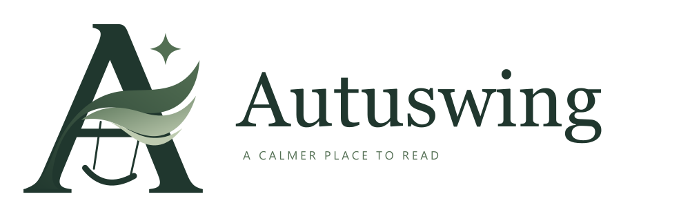

← [项目首页](../README.md) · [文档首页](index.md)

# 名称与品牌素材

**Autuswing / AutuSwing · 秋漾**，由 **Autu**mn 与 **Swing** 构成。对外字标采用 Autuswing；代码仓库名称继续使用 `astro-theme-autuswing`。标语为 **A calmer place to read.**，中文表达为「让文字有处安放，让阅读慢下来」。

  <picture>
    <source media="(prefers-color-scheme: dark)" srcset="assets/autuswing-header-dark.svg">
    
  </picture>

## 设计依据

本轮以用户提供的选定 PNG 为视觉参考，重新规范绘制 SVG：衬线 A、向右展开的绿色羽翼 / 书页、悬挂秋千和右上四角星。森林绿、鼠尾草绿和浅绿保持安静、轻盈的阅读气质。未复用旧 Hexo 的圆拱秋叶标志，也没有将位图改后缀伪装为矢量。

这些文件是依据选定设计制作、待审阅的矢量重绘稿，不声称是原设计师提供的矢量母版或逐像素描摹。参考 PNG 未直接收入仓库；若有原始矢量或高清透明母版，可在保持构图的前提下进一步校准曲线。

## 文件与用途

| 素材 | 用途 |
| --- | --- |
| [浅色横向头图 SVG](assets/autuswing-header-light.svg) / [深色版](assets/autuswing-header-dark.svg) | GitHub README，1000×320 |
| [浅色完整 Logo SVG](assets/autuswing-logo-light.svg) / [深色版](assets/autuswing-logo-dark.svg) | 纵向品牌展示，1000×760 |
| [浅色独立图形 SVG](assets/autuswing-mark-light.svg) / [深色版](assets/autuswing-mark-dark.svg) | 不带字的标志，512×512 |
| [单色图形 SVG](assets/autuswing-mark-mono.svg) | 简化单色使用 |
| [精简图标 SVG](assets/autuswing-icon.svg) / [512px PNG](assets/autuswing-icon-512.png) | 后续 favicon / PWA 的设计起点，未接入运行配置 |
| [浅色头图 PNG](assets/autuswing-header-light.png) / [深色版](assets/autuswing-header-dark.png) | 不支持 SVG 的展示环境 |

SVG 使用实际 path 与渐变，字标和英文标语已转轮廓，没有脚本、远程字体或嵌入 PNG。字标以本机 Georgia、标语以 Segoe UI 排版后转轮廓，不随包分发字体程序；不能据此声称字体由项目原创或改授 MIT。参考设计、字形和最终公开使用范围仍由维护者核实。

## 明暗与留白

- 浅色背景使用 light；深色背景使用 dark，避免直接反色。
- 保持原比例，四周至少预留图形高度约十分之一的空间，不拉伸或裁掉星与秋千。
- 横向头图建议至少 360 CSS px 宽；小空间使用独立图形，避免把完整标语缩到不可读。
- 精简版减去一层书页并加粗悬绳；32px 以上保留主要识别。16px 是辨识度下限，仅保留 A / 书页的整体轮廓，不要求秋千细节可分辨。
- 图标 PNG 是素材预览，未承诺已完成浏览器 favicon / PWA 安装验收，也未替换正式站任何图标。

README 使用 GitHub 支持的 picture 与 prefers-color-scheme 选择头图；替换文件时同时核对两种背景。本站真实截图及采集范围见[主题预览](preview.md)。项目品牌稿不构成第三方素材已全部获得公开发行许可的结论。
