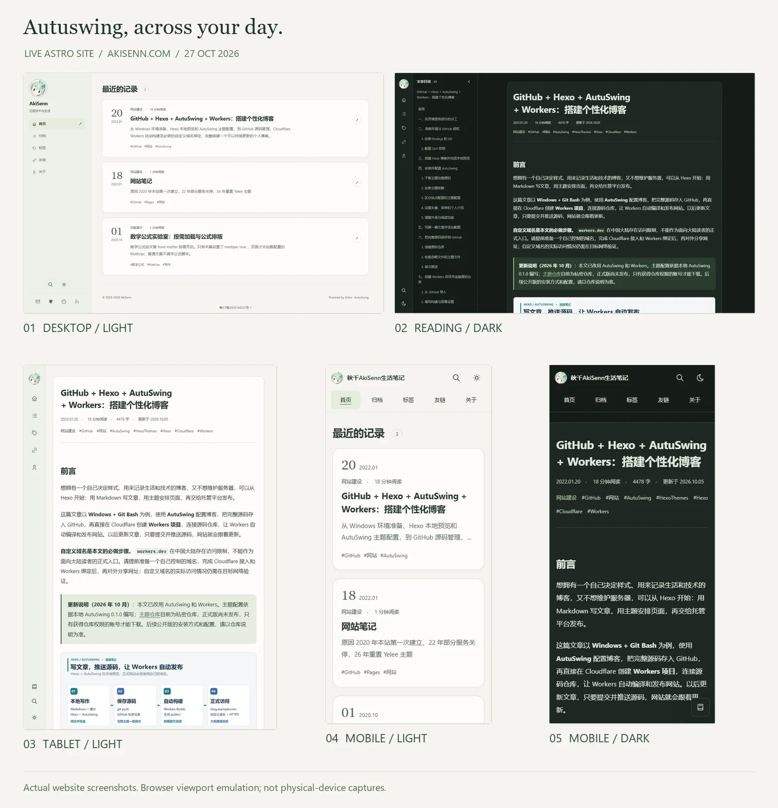

← [项目首页](../README.md) · [文档首页](index.md)

# Astro 正式站预览

这些图片来自 **https://akisenn.com/** 的真实 Astro 页面，于 2026-10-27 使用独立、无扩展的 Microsoft Edge 浏览器采集。深浅色使用浏览器 color-scheme 偏好，未改写页面 HTML、样式、文章或头像。

平板和手机指浏览器视口 / 触控模拟，不是 iPad 或 iPhone 真机截图，不替代测试角色的验收。当前正式站与文档 Git 基线的关系见[状态说明](repository-state.md)。截图中的个人身份、文章和页脚仅展示已经公开的站点，不作为新用户默认内容或可再分发素材。

| 场景 | 视口 | 截图 |
| --- | --- | --- |
| 桌面完整侧栏首页，浅色 | 1440×960 | [查看](assets/desktop-home-light.webp) |
| 桌面完整侧栏首页，深色 | 1440×960 | [查看](assets/desktop-home-dark.webp) |
| 桌面文章与目录，浅色 | 1440×960 | [查看](assets/desktop-article-light.webp) |
| 桌面文章与目录，深色 | 1440×960 | [查看](assets/desktop-article-dark.webp) |
| 平板文章，浅色 | 820×1180 | [查看](assets/tablet-article-light.webp) |
| 手机首页，浅色 | 390×844 | [查看](assets/mobile-home-light.webp) |
| 手机文章，深色 | 390×844 | [查看](assets/mobile-article-dark.webp) |

首页拼图只等比缩放并排列上述截图，外部文字用于标明场景；页面像素未被合成新内容。原始视口截图转为 WebP 以控制 README 体积。机器可读的时间、URL、视口和浏览器版本见[采集记录](assets/preview-captures.json)。

  

尚无原设计师的 Logo 矢量母版或新增真机截图；本轮已经具备选定参考 PNG 和真实站点的浏览器截图，不以旧 Hexo 图或生成图填补这些范围。若正式站日后改变，更新截图时应同时保存采集日期，不能继续将旧画面称为最新生产版本。
